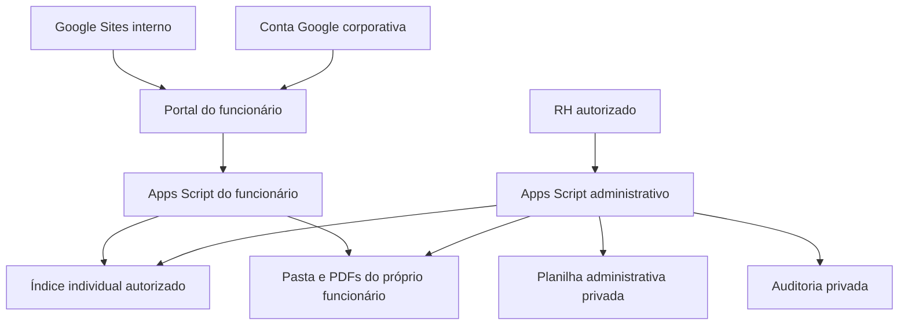
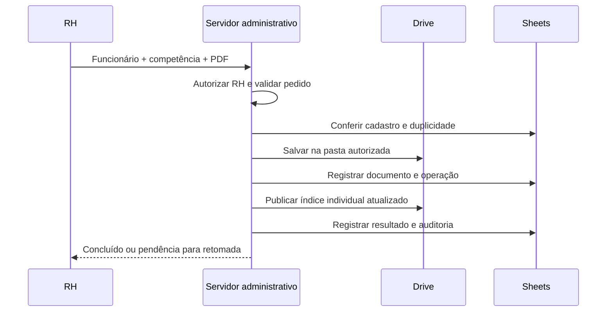

# Portal do Colaborador — documentação do novo projeto

**Data:** 12/10/2026

**Status:** especificação proposta; implementação e testes do novo projeto não iniciados.

**Revisão:** modelo sem matrícula, com `funcionario_id` interno automático aprovado em 12/10/2026.

**Público:** desenvolvedor com conhecimentos básicos de HTML, CSS e JavaScript; RH e responsáveis pelo ambiente Google Workspace.

Este documento descreve como construir uma nova aplicação, do zero. O protótipo anterior serve apenas como experiência para decisões conceituais. Seus arquivos, IDs, implantações, contas de teste e configurações não são requisitos para este projeto. As funcionalidades abaixo são previstas, não entregas já comprovadas.

## 1. Objetivo e escopo

O Portal do Colaborador permitirá que cada funcionário entre com sua conta corporativa Google, consulte informações profissionais e visualize ou baixe seus holerites em PDF. O público inicial previsto é de 31 a 100 funcionários.

O RH terá um aplicativo separado para cadastrar funcionários, atualizar informações, enviar documentos, corrigir associações e desativar acessos. A empresa continuará usando Google Sites como entrada do portal.

O projeto aproveitará serviços do Workspace já contratado. Não prevê servidor dedicado, banco de dados pago ou autenticação externa. Isso não garante capacidade ilimitada: licenças, armazenamento e quotas devem ser verificados no novo ambiente.

**Fora do escopo inicial:** cálculo de folha, geração dos holerites, controle de ponto, criação automática de contas Google, integração com ERP e assinatura eletrônica. Cadastrar um funcionário no portal não cria sua conta nem contrata uma licença Workspace.

## 2. Linguagens e serviços utilizados

| Tecnologia | O que é | Função no projeto |
|---|---|---|
| HTML | Linguagem de marcação | Estruturar cabeçalhos, formulários, listas e botões |
| CSS | Linguagem de estilos | Definir cores, espaçamento, tipografia e adaptação ao celular |
| JavaScript no navegador | Linguagem de programação | Atualizar telas, validar preenchimento e chamar o servidor |
| JavaScript no Apps Script | A mesma linguagem executada no ambiente Google | Validar identidade, autorizar operações e acessar serviços |
| Google Apps Script | Plataforma de execução, não uma linguagem independente | Hospedar os dois aplicativos e integrar Drive e Sheets |
| Google Drive | Serviço de arquivos | Armazenar PDFs e aplicar permissões individuais |
| Google Sheets | Serviço de planilhas | Manter cadastro, metadados e registros administrativos |
| Google Workspace | Ambiente corporativo | Fornecer contas, políticas e administração de acesso |
| Google Sites | Serviço de sites | Apresentar o link ou a incorporação do portal |
| JSON | Formato de dados | Representar configurações e índices individuais |
| Markdown | Formato de documentação | Preservar decisões, instruções e resultados de testes |

Os arquivos `.gs` contêm JavaScript do servidor. Os arquivos `.html` podem conter HTML e trechos de CSS/JavaScript, conforme a organização do projeto. O manifesto `appsscript.json` declara configurações do Apps Script. Não precisamos de PHP, Python, Java ou SQL para a aplicação proposta.

### Frontend e backend

**Frontend** é a parte que o funcionário vê no navegador. **Backend** é o código executado no Google. O frontend pode pedir uma operação, mas o backend decide se a pessoa pode realizá-la. Esconder um botão não protege uma função administrativa.

O navegador chamará funções do Apps Script por `google.script.run`. As chamadas são assíncronas: enquanto o servidor trabalha, a interface mostra carregamento; depois trata sucesso ou falha. [Documentação oficial da comunicação](https://developers.google.com/apps-script/guides/html/communication).

## 3. Arquitetura proposta



Teremos **dois projetos Apps Script**:

1. **Portal do funcionário:** consulta informações e documentos permitidos ao usuário autenticado.
2. **Painel do RH:** administra cadastro, arquivos, índices e permissões com a identidade de uma pessoa do RH autorizada.

A preferência inicial é executar ambos como o usuário que acessa. O funcionário não poderá ler a planilha central do RH. Sua consulta usará um índice individual preparado pelo aplicativo administrativo.

Um índice individual é um pequeno arquivo JSON com o perfil necessário e a lista de documentos daquela pessoa. Não contém valores salariais nem informações de terceiros. Não é outro banco de dados: é uma publicação controlada de parte do cadastro.

## 4. Por que usar um índice individual

Um Apps Script executado como funcionário só consegue acessar arquivos para os quais essa identidade possui permissão. A autorização OAuth para usar Sheets não torna uma planilha privada acessível.

| Alternativa | Vantagem | Limitação |
|---|---|---|
| Consultar diretamente a pasta individual | Menos componentes | Nome e situação do cadastro precisam de outra fonte; metadados limitados |
| Publicar índice individual | Preserva planilha central privada e fornece perfil/competências | Exige publicação, integridade e tratamento de informações desatualizadas |
| Serviço executado como proprietário | Centraliza acesso a dados privados | Aumenta o risco: acesso privilegiado exige identidade e autorização cuidadosamente verificadas |

**Recomendação:** índice individual e execução como visitante. A terceira alternativa não será adotada automaticamente.

Para um piloto, podemos associar e-mail a índice por configuração privada do servidor. Para a operação cotidiana, a associação deve ser administrada automaticamente pelo RH. A descoberta precisa localizar exatamente o índice confiável do e-mail autenticado; nenhum ID escolhido pelo navegador poderá substituir essa associação.

Se utilizarmos descoberta de arquivos que o funcionário consegue copiar ou criar, o backend deverá verificar assinatura de integridade, identidade destinatária e versão antes de aceitar um índice. HMAC-SHA256 é uma opção disponível no Apps Script. A chave fica apenas nos servidores; não aparece no HTML, repositório ou documentação. A assinatura não criptografa os dados nem substitui as permissões do Drive. [Utilities: HMAC](https://developers.google.com/apps-script/reference/utilities/utilities#computeHmacSha256Signature(String,String)).

A implementação detalhada desse mecanismo será decidida e testada na etapa de integração. Deve prever criação e rotação da chave, acesso restrito aos editores dos projetos, rejeição de índices ambíguos e limite de validade. Um índice antigo corretamente assinado ainda pode estar desatualizado; a assinatura sozinha não impede sua reutilização.

## 5. Autenticação e autorização

**Autenticação** responde “quem está acessando?”. Será feita pelo Google, sem formulário próprio de senha.

**Autorização** responde “o que essa pessoa pode fazer?”. Será aplicada pelo backend em cada operação.

Fluxo previsto:

1. Google exige acesso com conta corporativa.
2. O servidor consulta a identidade da sessão.
3. Confere se o e-mail está disponível e pertence ao domínio permitido.
4. Localiza o cadastro/índice confiável daquela identidade.
5. Verifica situação ativa e a autorização para a operação solicitada.
6. Só então devolve perfil e documentos permitidos.

`Session.getActiveUser().getEmail()` pode retornar vazio dependendo da execução e das políticas. Nesse caso, o acesso deverá ser negado com uma mensagem clara. Não usar e-mail enviado pelo navegador como alternativa. [Documentação de Session](https://developers.google.com/apps-script/reference/base/session).

A implantação deverá ser conferida como execução pelo visitante. Comparar identidade ativa e efetiva pode ajudar a detectar configurações erradas, mas testar apenas com o proprietário não comprova essa separação.

O domínio corporativo não transforma todos os usuários em RH. As operações administrativas exigirão uma lista explícita de contas ou um mecanismo equivalente de autorização validado no servidor.

## 6. Estrutura de armazenamento

```text
Drive compartilhado RH — Documentos Confidenciais/
├── Holerites/
│   ├── FUNC_<UUID_A>/
│   │   ├── indice.json
│   │   ├── 2026-09.pdf
│   │   └── 2026-10.pdf
│   └── FUNC_<UUID_B>/
│       ├── indice.json
│       └── 2026-10.pdf
├── Administrativo/
│   └── Cadastro e índice central (Google Sheets)
└── Arquivo restrito RH/
    └── Documentos substituídos, conforme política de retenção
```

Essa estrutura é uma proposta lógica. A localização do índice poderá ser ajustada durante os testes de descoberta. Os nomes `FUNC_<UUID_A>` e `FUNC_<UUID_B>` representam exemplos: o sistema usará o ID interno completo de cada funcionário, sem os sinais de menor/maior. A matrícula não será exigida nem exibida. A pasta terá nome baseado em `funcionario_id`, e seu identificador real do Drive será guardado separadamente em `pasta_id`.

### Permissões pretendidas

| Recurso | Funcionário correspondente | Outros funcionários | RH autorizado |
|---|---|---|---|
| Planilha central | Sem acesso | Sem acesso | Acesso administrativo necessário |
| Pasta individual e PDFs | Leitura | Sem acesso | Gestão de documentos e permissões |
| Índice individual | Leitura | Sem acesso | Publicação |
| Arquivo de documentos substituídos | Sem acesso | Sem acesso | Conforme retenção |
| Auditoria | Sem acesso | Sem acesso | Consulta restrita |

Funcionários não devem ser participantes gerais do Drive do RH. Não usar “qualquer pessoa com o link”, acesso geral ao domínio ou compartilhamento da pasta principal como solução para erros.

O Drive compartilhado deve permitir o compartilhamento individual necessário com usuários internos não participantes, sem abrir acesso externo. Políticas herdadas e restrições do administrador podem impedir isso: a configuração será validada na Etapa 01.

Um não participante pode conseguir abrir sua pasta sem conseguir consultar metadados da pasta mãe privada. Por isso, a hierarquia completa será validada pelo RH; o portal não deverá exigir acesso à raiz confidencial para funcionar. [Diferenças dos Drives compartilhados](https://developers.google.com/workspace/drive/api/guides/shared-drives-diffs).

## 7. Cadastro e índice central no Sheets

### Aba Funcionarios

| Campo | Significado e regra |
|---|---|
| funcionario_id | ID interno criado pelo servidor, único no cadastro e imutável; armazenado como texto |
| nome | Nome completo para exibição |
| email | Conta corporativa validada e normalizada; única para cadastro ativo |
| setor | Informação profissional necessária |
| pasta_id | Identificador real da pasta individual no Drive |
| indice_id | Identificador do índice individual publicado |
| ativo | Estado explícito de autorização, por exemplo SIM/NÃO |
| data_cadastro | Data/hora de criação |
| data_atualizacao | Data/hora da última atualização |
| revisao | Número para detectar edição concorrente |

### Aba Holerites

| Campo | Significado e regra |
|---|---|
| id | Identificador único do registro |
| funcionario_id | Referência ao ID interno de um funcionário existente |
| competencia | Ano e mês no formato YYYY-MM, por exemplo 2026-10 |
| arquivo_id | Identificador do PDF no Drive, não o nome do arquivo |
| nome_arquivo | Nome de exibição, normalmente 2026-10.pdf |
| data_upload | Data/hora de envio |
| responsavel_upload | E-mail do RH obtido no servidor |
| status | Estado do documento, como ATIVO ou ARQUIVADO |
| operacao_id | Referência para rastrear o envio e evitar repetição |

**Regra inicial proposta:** um holerite ativo por funcionário e competência. Se a empresa precisar de folha complementar, o modelo deverá incluir tipo/versão antes de implementar essa situação.

### Abas Auditoria e Operacoes

Auditoria registra data, responsável, ação, referência do funcionário/documento e resultado. Operacoes registra identificador do pedido, estado e passos executados para retomar uma falha sem duplicar arquivos.

### Identificação interna sem matrícula: viabilidade e regras

**Conclusão técnica:** o modelo é viável com as tecnologias propostas. O vínculo entre registros será definido pelo aplicativo; não depende de uma matrícula de folha. Apps Script fornece `Utilities.getUuid()` para gerar uma string UUID. O Google alerta que essa geração não oferece garantia universal de unicidade; por isso, o servidor deve conferir se o candidato já existe no cadastro antes de gravar e gerar outro se necessário. [Referência oficial de geração de UUID](https://developers.google.com/apps-script/reference/utilities/utilities#getUuid()).

Regras obrigatórias do novo modelo:

1. O RH informa nome, e-mail corporativo e setor. O servidor gera `funcionario_id` uma única vez, após autorizar o RH e validar os dados.
2. Geração, conferência de duplicidade e reserva do cadastro ocorrerão com bloqueio de concorrência. Escritas devem passar pelo mesmo projeto administrativo; edições manuais não participam desse bloqueio.
3. Uma retomada de cadastro reutiliza o ID já reservado na operação, sem gerar outro funcionário para o mesmo pedido.
4. O ID completo permanece igual quando nome, setor ou e-mail mudam. Não usar número de linha, nome pessoal, e-mail ou fragmento do UUID como chave principal.
5. `Funcionarios`, `Holerites`, índices individuais, auditoria e operações relacionam a pessoa por `funcionario_id`. A planilha não impõe essas referências automaticamente: o backend verifica funcionário existente e impede registros órfãos.
6. A autenticação continua pelo e-mail corporativo obtido no servidor. Esse e-mail deve corresponder a exatamente um cadastro ativo e ao índice confiável da identidade autenticada. Não permitir uma identidade atualizada acessar índices antigos de outra pessoa.
7. O ID fica fora dos formulários de preenchimento e do painel normal do funcionário. Pode existir nos dados internos; conhecer seu valor não concede acesso nem substitui autorização ou permissões do Drive.
8. Em envio de holerite, o RH seleciona nome e e-mail para distinguir pessoas com nomes iguais. A interface envia o ID escolhido, e o backend valida novamente a seleção e busca `pasta_id` no cadastro autorizado.
9. O ID não é o ID da conta Google, da pasta ou do PDF. São identificadores diferentes e cada um tem sua própria função.
10. Não reutilizar um cadastro antigo para outra pessoa quando um endereço corporativo for reaproveitado. A nova pessoa recebe novo ID, e as permissões e associações antigas devem estar revogadas. Recontratação da mesma pessoa exige decisão explícita do RH sobre preservar ou criar outro vínculo.

Exemplo fictício: `funcionario_id = 550e8400-e29b-41d4-a716-446655440000`. Os holerites dessa pessoa guardam o mesmo valor. Se o e-mail mudar, o ID e o vínculo com seus documentos permanecem; a associação de login e as permissões devem ser atualizadas por uma operação administrativa verificada.

O Sheets aceita valores de texto nas células, e o nome de pasta no Drive é uma string: nenhuma dessas APIs exige matrícula. Essas capacidades sustentam a proposta, enquanto a integridade dos vínculos será responsabilidade do backend. [Gravação de valores no Sheets](https://developers.google.com/apps-script/reference/spreadsheet/range#setValues(Object)), [nomes de pasta no Drive](https://developers.google.com/apps-script/reference/drive/folder#setName(String)).

**Limite da validação realizada:** compatibilidade das APIs e coerência do modelo verificadas por documentação oficial. Não foi executado cadastro real, geração de UUID no Apps Script remoto ou teste de permissões no novo ambiente. Esses testes continuam obrigatórios antes da conclusão das etapas correspondentes.

Não guardar salário, conteúdo do PDF, senhas, tokens ou chaves nessas abas. A planilha deve ter acesso e edição restritos. Escritas administrativas devem neutralizar entradas que poderiam ser interpretadas como fórmulas.

## 8. Funcionamento do painel do funcionário

Ao entrar, a pessoa verá seu nome, setor e e-mail autenticado. Não haverá campo de matrícula nem exibição habitual do ID interno. A seção “Meus holerites” mostrará competências, filtro por ano, botão Visualizar e botão Baixar.

O servidor devolverá somente os documentos presentes no índice válido daquele funcionário. Ao pedir um documento, verificará novamente a identidade e se o ID pertence à lista autorizada. O Drive ainda verificará suas próprias permissões quando a pessoa abrir o PDF.

Não expor um endpoint genérico que aceite qualquer arquivo do Drive. Conhecer um ID não concede autorização.

Estados da tela: carregando, documentos disponíveis, nenhum documento, cadastro não configurado, acesso negado e erro temporário. Mensagens ao funcionário não devem revelar nomes, e-mails ou IDs de terceiros. Detalhes técnicos ficam em registro administrativo seguro.

## 9. Cadastro de um novo funcionário

1. RH acessa o aplicativo administrativo e passa pela autorização do servidor.
2. Preenche nome, e-mail corporativo e setor, sem matrícula ou ID manual.
3. Backend valida campos, duplicidades e regras do domínio; gera, confere e reserva o `funcionario_id` automático para essa operação.
4. Cria a pasta individual e concede leitura à conta correta.
5. Registra o cadastro na planilha privada.
6. Publica o índice individual e estabelece sua associação confiável.
7. Registra auditoria e apresenta o resultado.

Se houver falha após criar a pasta, o sistema mostrará uma pendência rastreável. Não deverá afirmar que o cadastro terminou nem criar outra pasta cegamente ao tentar novamente.

No sistema final, o RH não precisará copiar IDs para cada novo cadastro. Essa automação pertence à etapa administrativa; a preparação inicial poderá usar configuração manual controlada.

## 10. Envio de um holerite



O backend escolherá a pasta a partir do cadastro confiável, não de um caminho livre enviado pelo navegador. Validará funcionário ativo, competência, tamanho máximo configurado e formato PDF. Conferir extensão e assinatura básica do arquivo não equivale a uma análise contra malware.

Após a publicação, o funcionário reconsultará o portal para ver o novo documento. Não será necessário alterar o código ou fazer nova implantação a cada holerite.

## 11. Edição, correção e desligamento

**Alteração de nome/setor:** atualizar cadastro, revisão e índice individual, registrando responsável e resultado.

**Mudança de e-mail:** tratar como operação sensível, preservando o `funcionario_id`. Verificar unicidade, associação de identidade, índices antigos e novos e permissões. Os documentos continuam ligados ao mesmo ID interno. Não basta atualizar uma célula: revogar associações e acessos antigos, publicar o índice atualizado e verificar o resultado. O ID interno não será editável em operações comuns.

**Documento incorreto:** exigir confirmação, retirar da lista ativa e mover para arquivo restrito conforme política. Verificar permissões diretas que possam permanecer no arquivo após a movimentação. Se necessário, enviar a versão correta e registrar a substituição.

**Desativação:** bloquear o cadastro/índice e revogar acesso aos documentos, verificando permissões diretas, grupos e heranças. Marcar `ativo=NÃO` na planilha não impede sozinho a abertura de um link do Drive.

Um índice é uma fotografia do cadastro. Enquanto uma publicação estiver pendente, o portal pode não conhecer uma alteração central. O projeto deverá definir prazo máximo de validade, atualização e comportamento de bloqueio para índices vencidos. Revogação de permissões e suspensão da conta são controles relevantes em desligamentos urgentes.

Não é possível recolher automaticamente cópias já baixadas. Os documentos originais serão preservados conforme a política aprovada; excluir arquivos não é parte automática da desativação.

## 12. Concorrência e falhas parciais

Dois usuários do RH podem tentar editar o mesmo cadastro ou enviar a mesma competência. Usaremos bloqueios, revisão de registros e checagem de duplicidade dentro da seção protegida.

`LockService` coordena trechos de código concorrentes. Ele não bloqueia edições manuais na interface do Sheets e não cria uma transação única entre Drive e Sheets. [Documentação de LockService](https://developers.google.com/apps-script/reference/lock/lock-service).

Cada operação terá um identificador e passos registrados. Repetir um pedido deve retomar o trabalho ou devolver o resultado existente, evitando duplicação. Estados previstos: em andamento, concluída, falha e parcialmente concluída. Limpeza ou compensação não poderá apagar documentos válidos sem autorização.

Exemplo: PDF salvo, mas índice não publicado. O RH receberá “documento salvo; publicação pendente”, e a retomada atualizará o índice sem salvar outro PDF.

## 13. Configurações do novo ambiente Google

Os nomes dos menus podem variar por licença e atualizações. Cada configuração deve ser registrada com o valor efetivamente disponível no ambiente.

### Google Workspace

No Console do administrador, conferir **Apps → Google Workspace → Drive e Documentos** e a disponibilidade do Apps Script. Validar domínio, licenças, armazenamento, compartilhamento externo e políticas de autorização de aplicativos. Definir as contas RH, funcionário A e funcionário B.

Aplicar verificação em duas etapas às contas administrativas conforme a política da empresa. Separar permissão de administrador do Workspace da autorização funcional do RH; uma conta não precisa receber poderes globais apenas para enviar holerites.

### Google Drive

Em **Drive → Drives compartilhados**, criar o espaço confidencial do RH. Definir participantes administrativos, bloquear acesso externo e testar compartilhamento interno individual sem tornar funcionários participantes gerais. Criar pastas de testes e verificar acesso direto aos links com A e B.

Se a licença ou política inviabilizar esse modelo, avaliar Meu Drive institucional com propriedade e continuidade organizacional planejadas. A escolha só estará fechada após testar permissões.

### Google Sheets

Criar a planilha na área privada administrativa. Em **Compartilhar**, deixar acesso geral restrito e incluir apenas responsáveis necessários. Criar abas e cabeçalhos, sem coluna de matrícula. Tratar `funcionario_id` como texto, padronizar competências e datas e restringir edições manuais para reduzir inconsistências.

### Google Apps Script

Criar dois projetos em **script.google.com → Novo projeto**. Definir nomes distintos, fuso horário e editores autorizados. Em **Configurações do projeto**, habilitar exibição do manifesto quando necessário e configurar propriedades privadas do servidor.

Configurações previstas incluem domínio autorizado, identificação da raiz do Drive, planilha administrativa no projeto RH, lista de responsáveis RH e parâmetros de publicação. Segredos devem ser inseridos manualmente em destino privado e nunca incluídos no repositório.

Em **Implantar → Nova implantação → Aplicativo da Web**, escolher execução pelo usuário que acessa e restrição organizacional disponível. Validar com outra conta. A URL `/dev` é destinada a editores para testes do código salvo; a URL `/exec` será utilizada na implantação versionada para os usuários. [Guia de aplicativos Web](https://developers.google.com/apps-script/guides/web).

### OAuth e escopos

OAuth é a autorização para o aplicativo usar serviços Google em nome da pessoa. Os escopos declaram quais capacidades serão solicitadas; não substituem autorização RH nem permissões dos arquivos.

O portal deverá solicitar apenas identificação e leitura do Drive necessárias. Ler o conteúdo JSON exige capacidade de leitura de arquivos; leitura apenas de metadados não basta. O RH precisará de escrita no Drive e acesso à planilha. O uso de `SpreadsheetApp.openById` requer o escopo adequado de planilhas, conforme a documentação do método.

A lista exata será definida após escolher as APIs utilizadas e revisada nos testes. Usar escopos explícitos e evitar serviços desnecessários. [Autorização nos serviços Google](https://developers.google.com/apps-script/guides/services/authorization).

### Google Sites

Inicialmente, adicionar um botão para abrir o portal em outra aba. Isso facilita diagnosticar login e permissões. A incorporação será avaliada depois, considerando comportamento em navegadores e dispositivos. A permissão de leitura do Sites não concede acesso automático aos PDFs.

## 14. Organização proposta do novo repositório

```text
portal-colaborador/
├── AGENTS.md
├── README.md
├── .gitignore
├── colaborador/
│   ├── appsscript.json
│   ├── Code.gs
│   ├── Auth.gs
│   ├── Perfil.gs
│   ├── Holerites.gs
│   ├── Indices.gs
│   ├── Index.html
│   ├── Styles.html
│   └── Scripts.html
├── rh/
│   ├── appsscript.json
│   ├── Code.gs
│   ├── AutorizacaoRH.gs
│   ├── Funcionarios.gs
│   ├── Documentos.gs
│   ├── Permissoes.gs
│   ├── PublicacaoIndices.gs
│   ├── Auditoria.gs
│   ├── Operacoes.gs
│   └── Painel.html
├── docs/
│   ├── ARQUITETURA.md
│   ├── DECISOES.md
│   ├── SEGURANCA.md
│   ├── CONFIGURACAO.md
│   ├── HISTORICO.md
│   ├── PROGRESSO.md
│   └── etapas/
└── tests/
    └── CHECKLIST.md
```

Essa estrutura não foi criada como implementação. Ela propõe separar os dois projetos claramente, evitando misturar manifestos e funções. Backend e HTML devem ter nomes distintos quando o editor não permitir nomes repetidos.

Não colocar PDFs reais, dados pessoais de produção, credenciais ou arquivos de segredo no repositório. Ambientes de teste e produção terão recursos e configurações separados.

## 15. Segurança e privacidade

Controles necessários: identidade no servidor; autorização em todas as operações; isolamento no Drive; planilha privada; validação de entradas; prevenção de exposição de segredos; conteúdo da interface tratado como texto para evitar injeção; auditoria sem conteúdo salarial; acesso administrativo restrito.

A retenção será definida pelo RH e pelos responsáveis por segurança/privacidade. A preferência por guardar documentos permanentemente não será tratada como regra legal comprovada. Esta especificação não atesta conformidade com a LGPD.

A auditoria deve permitir identificar quem cadastrou, enviou, alterou ou desativou, sem copiar o conteúdo dos holerites. Uma planilha editável por administradores não é uma trilha inviolável; a empresa deverá avaliar controles adicionais e logs do Workspace disponíveis na licença.

A produção dependerá de homologação técnica e aprovação interna. Nenhum índice assinado, filtro visual ou teste local isolado comprova a segurança completa.

## 16. Testes e critérios de aceitação

| Teste real obrigatório | Resultado esperado |
|---|---|
| A acessa seu portal e PDF | Perfil correto e documento abre |
| A tenta abrir PDF/pasta de B | Acesso negado também pelo Drive |
| B tenta consultar dados de A | Nenhum dado de A é devolvido |
| Usuário externo abre portal | Acesso negado |
| Funcionário chama função RH diretamente | Backend nega a operação |
| Navegador altera e-mail, ID ou competência | Não consegue ampliar acesso |
| Índice é alterado ou pertence a outra identidade | Rejeitado |
| Funcionário é desativado | Portal bloqueado e links antigos sem acesso após revogação |
| RH envia competência repetida | Regra de duplicidade aplicada sem criar cópia |
| Dois pedidos simultâneos | Resultado consistente ou conflito explícito |
| Cadastro sem matrícula | ID gerado no servidor; campo não solicitado nem exibido |
| Colisão de ID simulada e retomada do pedido | Sem ID duplicado; retomada mantém o ID reservado |
| Alteração de nome/e-mail e pessoas homônimas | Documentos preservam o vínculo pelo ID; acessos antigos são revogados |
| ID de outro funcionário enviado ao portal | Backend nega; ID conhecido não concede acesso |
| Holerite com funcionario_id inexistente | Registro rejeitado, sem vínculo órfão |
| E-mail reaproveitado para outra pessoa | Novo ID e nenhum acesso ao histórico da identidade anterior |
| Falha entre Drive e Sheets | Pendência registrada; retomada sem duplicar |
| Funcionário sem documentos | Mensagem adequada, sem erro técnico |
| Desktop e celular | Conteúdo legível e ações utilizáveis |
| Volume representativo | Tempos e quotas compatíveis com operação prevista |

Testes automatizados verificarão regras, validações e fluxos com serviços simulados. Testes manuais verificarão identidade, OAuth, heranças, compartilhamento, PDFs e comportamento real no Google. Aprovação dos primeiros não substitui os segundos.

**Situação deste documento:** nenhum teste funcional do novo sistema foi executado. Os critérios acima são o plano de validação.

## 17. Quotas, manutenção e recuperação

Apps Script possui limites de execução e uso dos serviços, que variam por conta e podem mudar. Planejar consultas enxutas, publicação incremental e processamento em lotes. Medir com a carga esperada antes de prometer capacidade. [Quotas oficiais](https://developers.google.com/apps-script/guides/services/quotas).

Manutenção prevista: cadastrar/desativar pelo RH; acompanhar operações pendentes; revisar permissões e contas administrativas; manter documentação; atualizar versões de código somente quando houver alterações na aplicação.

Definir backup e recuperação para cadastro, PDFs, código e configurações. Testar uma restauração em ambiente separado, incluindo revisão das permissões antes de liberar acesso. Backup não substitui controle de acesso nem política de retenção.

## 18. Desenvolvimento por etapas

| Etapa | Entrega e condição para avançar |
|---|---|
| 01 — Preparação e planejamento | Domínio, licença, contas, armazenamento e modelo de autorização validados |
| 02 — Autenticação | Identidade corporativa comprovada com duas contas e rejeição de acesso indevido |
| 03 — Interface | Painel responsivo com dados fictícios e estados de tela |
| 04 — Drive | PDFs fictícios isolados, listagem, visualização e download |
| 05 — Sheets e índices | Cadastro privado, publicação confiável e atualização validada |
| 06 — Painel RH | Cadastro, envio, edição, desativação, correção e auditoria testados |
| 07 — Segurança e testes | Relatório integrado, revisão de quotas e resolução de pendências críticas |
| 08 — Google Sites e produção | Piloto aprovado, implantação, suporte e recuperação documentados |

Uma etapa será explicada, implementada, testada e documentada antes da próxima. Testes manuais exigem confirmação do usuário. Não avançar sem autorização. Atualizar README, HISTORICO, PROGRESSO, ARQUITETURA, DECISOES e o documento da etapa, distinguindo planejado, implementado e validado.

## 19. Decisões a confirmar na preparação

- Domínio e plano do novo ambiente; capacidade de armazenamento disponível.
- Contas reais de teste A/B/RH e responsáveis administrativos.
- Viabilidade de compartilhamento individual no Drive escolhido.
- Modelo final de associação e integridade dos índices individuais.
- Política de retenção, substituição de documentos e desligamento.
- Regra para holerites complementares e mudanças de identidade.
- Limite de PDF, validade dos índices e prazos de atualização.
- Responsáveis por aprovação interna, manutenção e recuperação.

O primeiro passo da implementação será validar essas condições da Etapa 01 no novo ambiente. Esta entrega autoriza apenas a documentação solicitada; não inicia configuração remota nem desenvolvimento de etapas posteriores.
